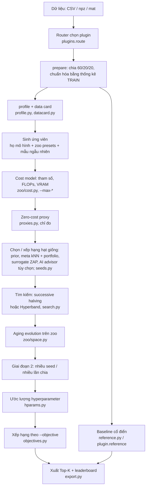

# Kiến trúc DLNet

Tài liệu này mô tả DLNet được tổ chức thế nào và dữ liệu đi qua những bước nào. Chi tiết thuật toán ở [algorithms.md](algorithms.md); cách dùng ở [user-guide.md](user-guide.md).

## 1. Pipeline của `dlnet design`



Ngân sách (`--budget`, giây hoặc epoch, `dlnet/clock.py`) chia: tối đa 10% cho proxy (tính từ lúc bắt đầu bước proxy), 80% đầu cho tìm kiếm và tiến hóa, 20% cuối cho hyperparameter. Một lần huấn luyện chỉ được bắt đầu khi dự báo xong trước hạn của giai đoạn (`search.Pace`: giây/epoch đo trên trainer, hoặc theo FLOPs cho ứng viên chưa train; ngân sách epoch thì đúng bằng số epoch). Hết giờ giữa chừng thì DLNet vẫn xếp hạng những gì đã xong và luôn có ít nhất một kết quả. `clock.stage()` ghi giây và epoch của từng giai đoạn vào khối `budget` của leaderboard.

Thiết bị (`--device`, `--amp`): `core.Trainer` đặt mô hình lên thiết bị, chép dữ liệu lên đó một lần cho mỗi bộ dữ liệu (`Trainer.split`; HSI chép cả cube và cắt patch trên GPU, `hsi_data.PatchStore.to`), dùng autocast (bf16, hoặc fp16 kèm `GradScaler`) và `channels_last` cho ảnh trên CUDA. Ước lượng hyperparameter dùng thiết bị của trainer. Data card, proxy, surrogate, cost model (thiết bị `meta`) và baseline cổ điển chạy trên CPU. Gói xuất ra có cùng `core.py`, nên `train.py --device/--amp` cũng dùng GPU.

Cả lần chạy nằm trong `threads.limit(n)` (`--threads`): torch, OpenBLAS và hai runtime OpenMP (torch, scikit-learn) bị giới hạn cùng một số luồng, tránh treo khi nhiều tiến trình tranh CPU.

## 2. Thư mục mã

| Đường dẫn | Vai trò |
|---|---|
| `dlnet/cli.py` | Lệnh `design`, `selfcheck`, `zoo`; nối mọi bước ở trên |
| `dlnet/plugins/` | Mọi thứ phụ thuộc loại dữ liệu: `tabular.py`, `hsi.py`, `arrays.py` (ảnh phân loại, phân đoạn, tái tạo; chuỗi thời gian; đồ thị; recommender) |
| `dlnet/core.py`, `array_data.py`, `hsi_data.py` | Nạp, chia, chuẩn hóa dữ liệu; `Trainer` (AdamW, cosine, chọn checkpoint theo validation) |
| `dlnet/zoo/` | Kho module và ngữ pháp kiến trúc (mục 3) |
| `dlnet/search.py` | Successive halving, Hyperband, giai đoạn nhiều seed, cache lần chạy, chọn Top-K đa dạng |
| `dlnet/objectives.py` | Hướng tối ưu: accuracy, params, flops, balanced (MnasNet), pareto (NSGA-II) |
| `dlnet/datacard.py`, `seeds.py`, `meta.py`, `surrogate.py` | Đặc trưng dữ liệu, chọn hạt giống, học từ các lần chạy trước (kNN, portfolio, surrogate ZAP) |
| `dlnet/advisor.py`, `mcp_server.py` | Tùy chọn AI: advisor gọi AI CLI; MCP server `dlnet mcp` ([ai-advisor.md](ai-advisor.md)) |
| `dlnet/proxies.py`, `hparams.py`, `profile.py` | Zero-cost proxy; lr / batch / weight decay; intrinsic dimension |
| `dlnet/export.py`, `reference.py` | Gói đầu ra, leaderboard, quy tắc kết luận; baseline cổ điển |
| `dlnet/clock.py`, `threads.py`, `jsonsafe.py` | Đồng hồ ngân sách và báo cáo theo giai đoạn; giới hạn luồng; ghi JSON chuẩn (`NaN` → `null`) |
| `dlnet/unfold*.py`, `gan_*.py` | Lệnh `unfold` (LISTA) và `gan` (DCGAN) |
| `scripts/` | Đối chiếu với mã gốc (`verify_*.py`), đo đạc (`bench_*.py`), phát hành, sinh tài liệu |

## 3. Kho module (zoo)

Mọi mạng của DLNet được mô tả bằng một **spec** JSON và dựng bởi `dlnet/zoo/core.py`.

- **Kiểu tensor** (không tính chiều batch): `vec (D)`, `seq (T, D)`, `ser (C, T)`, `map (C, H, W)`, `vol (C, D, H, W)`, `graph (N, F+N)`, `ids (F)`.
- **Op**: một module một vào một ra, đăng ký bằng `@op(name, kinds, kout, space, tags, source)`. `space` liệt kê giá trị hợp lệ của tham số; `tags` (`block`, `down`, `attn`, `stem`, `adapt`, ...) cho ngữ pháp biết op được đặt ở đâu. Danh mục: [zoo.md](zoo.md).
- **Combinator**: `seq`, `res` (residual, có drop path), `par` (nhánh song song: concat / sum / gate), `rep` (lặp), `moe` (mixture of experts: soft / top-k / product), `encdec` (encoder nhiều stage + một trong 11 decoder phân đoạn).
- **Kiểm tra tĩnh**: `zoo.check(spec, kind, dims)` dựng mạng trên thiết bị `meta` (không tốn bộ nhớ) để suy ra shape và số tham số; spec sai bị loại trước khi huấn luyện.
- **Head**: `build_model` thêm head phân loại / hồi quy (`cls`), dự đoán dày (`dense`) hoặc không (`none`).
- **Ngữ pháp** (`zoo/space.py`): lấy mẫu kiến trúc ngẫu nhiên đúng kiểu, 9 phép đột biến (đổi tham số, đổi op, chèn, xóa, bọc residual, lặp, đổi độ rộng, thành MoE, đổi decoder), lai ghép.
- **Preset** (`zoo/presets.py`): kiến trúc nổi tiếng viết thành spec (ResNet, ResNeXt, DenseNet, MobileNet, EfficientNet, ConvNeXt, RegNet, Swin-like, ViT, GhostNet, RepVGG, PoolFormer, Res2Net, SKNet, ResNeSt, U-Net, Unet++, DeepLabV3+, ...).
- **Họ mô hình** (`zoo/families.py`): công thức "cấu hình → spec" cho từng miền (tabular, image, segmentation, timeseries, hsi, graph, recsys, reconstruction).
- **Nguồn**: torchvision, timm, segmentation_models_pytorch, MONAI, rasbt/deeplearning-models, cortex, openrec, mamba; 63 khối đã đối chiếu số học với mã gốc ([THIRD_PARTY.md](../THIRD_PARTY.md)).

## 4. Plugin

Một plugin (`dlnet/plugins/__init__.py: DomainPlugin`) cài: `detect` (độ tin cậy dữ liệu thuộc về nó), `prepare`, `profile`, `generate` (họ mô hình), `zoo_input` (kiểu tensor cho zoo), `build_model`, `reference` (baseline cổ điển cùng mức thông tin), `reference_for` (baseline công bằng cho một cấu hình, ví dụ PCA cùng kích thước mã cho autoencoder), mẫu `train.py` và test của gói xuất.

| Plugin | Dữ liệu | Metric chính |
|---|---|---|
| `tabular` | CSV + `--target` | accuracy / balanced accuracy / RMSE |
| `hsi` | cube siêu phổ + ground truth (`.mat`, `.npz`, `.npy`) | OA, kappa |
| `image_classification` | `.npz`: `X (N,H,W[,C])`, `y (N,)` | accuracy |
| `image_segmentation` | `.npz`: `X`, mask `y (N,H,W)` | mIoU |
| `image_reconstruction` | `.npz`: chỉ `X` | MSE, PSNR |
| `timeseries` | `.npz`: `X (N,T[,C])`, `y` | accuracy / RMSE |
| `graph` | `.npz`: `X (G,N,F)`, `A (G,N,N)`, `y (G)` | accuracy |
| `recsys` | `.npz`: `ids (N,F)` nguyên, `y` | RMSE / accuracy |

## 5. Gói đầu ra

```
dlnet_out/
  leaderboard.md, leaderboard.json   xếp hạng, baseline, kết luận, Pareto front, proxy, data card, ngân sách
  profile.json                       hồ sơ dữ liệu
  reference/results.json             baseline cổ điển
  top1_<họ>/                         một gói độc lập cho mỗi baseline
    model.py  core.py  array_data.py  zoo/    mã dựng và huấn luyện (không phụ thuộc DLNet)
    config.yaml                       spec, hyperparameter, cách dựng lại dữ liệu
    train.py                          huấn luyện đầy đủ: python train.py --data ...
    report.md                         số đo, nguồn gốc, chi phí
    tests/test_model.py               kiểm tra shape
```

Không có trọng số trong gói: kết quả tìm kiếm là kết quả của ngân sách ngắn, nên gói được huấn luyện lại bằng `train.py`.

## 6. Nguyên tắc đánh giá

- Mọi bước fit (chuẩn hóa, PCA) chỉ dùng split train; HSI chia theo khối được đề xuất để tránh rò rỉ.
- So với baseline cổ điển cùng mức thông tin; top-1 chỉ được ghi "thắng" khi hơn baseline tốt nhất trên validation quá mức nhiễu **và** hơn mọi baseline trên test.
- Proxy và quy tắc chọn hạt giống không loại ứng viên khi chưa có số đo chứng minh (`agent.md` §16).
